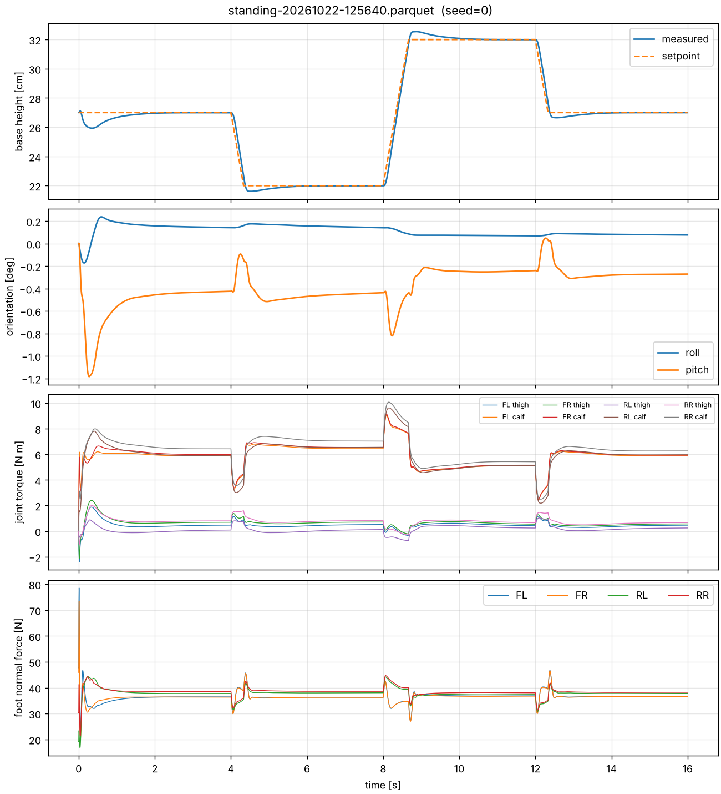

# go2-wbc

Whole-body locomotion and state estimation for the Unitree Go2 quadruped, built
simulation-first in MuJoCo. The goal is the full stack a legged-robotics team
owns: estimation, gait scheduling, QP-based whole-body control, safety, and a
quantitative benchmark suite, rather than a pretrained policy.

> **Status: Phase 1 complete.** Deterministic environment, standing controller
> with height regulation, safety monitor, logging and tests. Next: state estimation.



## Quick start (macOS / Linux)

```bash
brew install uv            # or: curl -LsSf https://astral.sh/uv/install.sh | sh
uv sync                    # creates .venv with Python and all dependencies
uv run pytest -q           # ~30 s; first run downloads the Go2 URDF for Pinocchio
```

Run the standing controller:

```bash
# headless, faster than real time, writes a Parquet log
uv run python scripts/run_standing.py --duration 30 --log

# height-step test, then plot it
uv run python scripts/run_standing.py --height-steps 0.27 0.22 0.32 0.27 --step-every 4 --log
uv run python scripts/make_plots.py

# with the viewer (on macOS the viewer must run under mjpython)
uv run mjpython scripts/run_standing.py --viewer --height-steps 0.27 0.20 0.33 --step-every 3
```

Just look at the robot: `uv run python -m mujoco.viewer --mjcf models/go2/scene.xml`

## Phase 1 results

Flat ground, seed 0, 500 Hz physics and control, ground-truth state.

| Metric | Result | Target |
|---|---|---|
| Stand duration without fault | 30 s (seeds 0–2) | ≥ 30 s |
| Height RMS error, steady stance | 0.3–0.4 mm | < 5 mm |
| Height RMS error, 22–32 cm step test | 2.5 mm | < 5 mm |
| Max body tilt | 0.7–1.2° | < 5° |
| Steps with torque saturation | 0 % | 0 % |
| Speed vs real time (headless, cloud Linux CPU) | ~6–10× | ≥ 1× |

The remaining ~1 cm dip right after reset and the ~5 mm overshoot at each
height step are the height integrator settling. See `docs/failures.md` (F-001,
F-002) for how the startup went from a 5 cm dip to this.

## Layout

```
configs/      robot conventions, sim settings, controller gains (YAML)
models/go2/   vendored Menagerie MJCF (pinned commit in SOURCE.md)
src/go2_wbc/
  robot.py            canonical joint order -> MuJoCo index maps, by name
  sim/mujoco_env.py   Go2Env: seeded reset, torque step, SimState, IMU sensors
  control/            joint PD, stance controller, safety monitor
  runner.py           closed-loop run shared by scripts and tests
  utils/              quaternion helpers, Parquet run logger
scripts/      run_standing, make_plots, fetch_model
tests/        index mapping, determinism, standing acceptance, safety, Pinocchio FK
docs/         robot_model.md (conventions), failures.md (what broke and why)
```

## Design rules

- **No implicit indexing.** Nothing touches `qpos`/`qvel`/`ctrl` by hard-coded
  offset; `RobotIndex` maps names to addresses and fails loudly on mismatch.
- **One quaternion convention** ([w, x, y, z]); conversion only at the Pinocchio boundary.
- **Deterministic.** Same seed gives a bit-identical trajectory (tested).
- **Controller and simulator use different models** (URDF vs MJCF); the
  mismatch is documented and measured rather than hidden. See `docs/robot_model.md`.
- **Every surprise goes in `docs/failures.md`.**

## Roadmap

- [x] Phase 0: environment, model, config, logging
- [x] Phase 1: standing and height regulation
- [ ] Phase 2: IMU + leg-odometry state estimation (InEKF), vs. ground truth
- [ ] Phase 3: trot scheduler and swing trajectories
- [ ] Phase 4: QP whole-body controller
- [ ] Phase 5: terrain, pushes, sensor noise, actuator realism; benchmark suite
- [ ] Phase 6: C++ port of the control loop, write-up

## Scope

Simulation only, by design: no hardware port and no ROS 2 layer. The time goes
into making the simulation harder than the default model (sensor noise, latency,
motor limits, model mismatch) so results say something about transfer.

## Credits

Go2 MJCF from [MuJoCo Menagerie](https://github.com/google-deepmind/mujoco_menagerie)
(BSD-3-Clause). Go2 URDF from [unitree_ros](https://github.com/unitreerobotics/unitree_ros).
